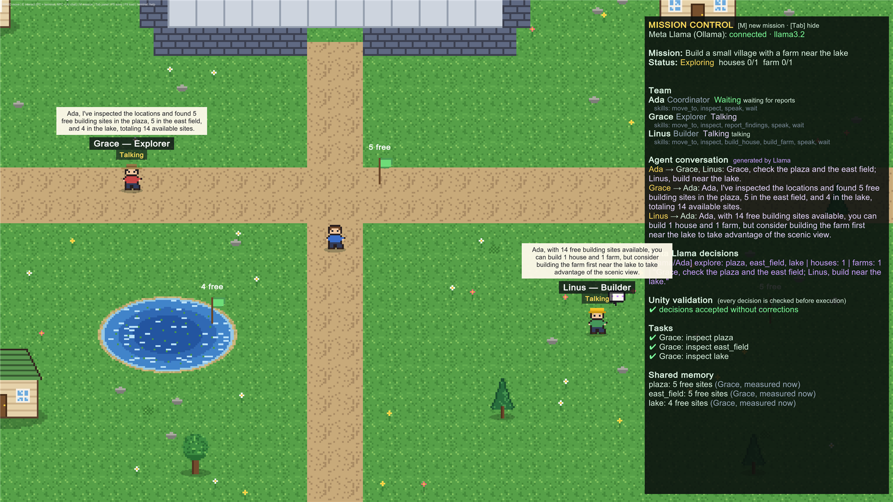
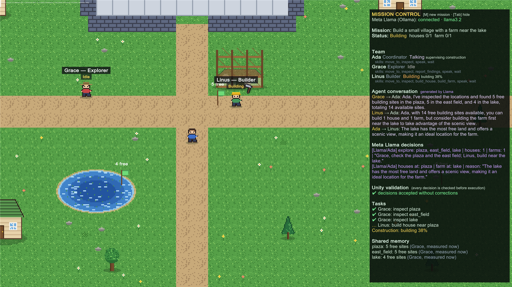

# AgentWorld — Build, Test & Share AI Agents

**An open-source visual laboratory for building, testing, and understanding collaborative AI agents powered by Meta Llama.**



AgentWorld is a Unity 6 pixel-art world where three AI agents plan, talk, scout and build together.
Meta Llama 3.2 runs **locally through Ollama**. It makes the decisions and writes the agents' dialogue,
while Unity **validates every decision against the live world** and executes it deterministically.
Developers can configure the agents, give them skills from a registry, watch them collaborate, and
evaluate missions with measured metrics.

> Built for the Meta Global AI Developer Hackathon 2026 · Unity **6000.0.60f1** · Windows · Meta Llama 3.2 3B via Ollama

## Why

AI agents are hard to observe and hard to trust. In a chat log you can't see *who* decided *what*,
whether the decision was valid, or how often the model gets it wrong. AgentWorld puts agents in a world
where every step is visible and every model output passes through a validator before anything happens.

**Three differentiators**
1. **Visible collaboration.** Ada (coordinator), Grace (explorer) and Linus (builder) talk to each other
   in speech bubbles, share a structured memory, and work in the same world.
2. **Safe execution.** Llama proposes JSON. Unity checks it against the skill registry, the agent's
   allowed skills and the real world state (existing places, free land, capacity), then executes. Model
   text is never executed as code.
3. **Developer extensibility.** Skills live in a registry (`SkillRegistry`), agents are configured in
   `agents.json`, and missions can be evaluated with `eval run <scenario>`, which produces a JSON report.

## What happens in a mission

`mission build a small village near the lake` (or press **M** and type it):

1. **Ada → Llama:** is this feasible for the team? Which places should Grace scout? How many houses and farms?
   If the request is outside the team's skills (for example "build a castle on the lake"), Ada explains why
   and the mission ends as **Unsupported**. Nothing is faked.
2. **Grace** walks to each place. **Unity measures** the free building sites there, and Grace plants a
   flag and writes a `SiteReport` to shared memory.
3. **Team dialogue (Llama):** Grace reports the measured numbers to Ada; Linus judges feasibility and gives a tip.
4. **Ada → Llama:** picks sites using the reports and the dialogue. Unity rejects places that weren't
   explored or that are over capacity, and Llama gets one retry with the error.
5. **Linus** walks to each site; scaffolding and dust appear; the house or farm rises. If a site filled up
   in the meantime, Unity recovers by using another reported location.
6. The outcome is reported honestly: Succeeded / Partial / Failed / Cancelled / Unsupported.



## How we use Meta's open-weight AI

| | |
|---|---|
| Model | **Meta Llama 3.2 3B Instruct** (`llama3.2`, ~2 GB), open weights |
| Runtime | **Ollama** on the user's own computer, `http://localhost:11434`, `/api/chat` (JSON mode for decisions) |
| Not used | Meta Model API, hosted inference, paid APIs, API keys |
| Llama decides | feasibility, mission decomposition, site selection, specialist routing, single-agent action plans, agent dialogue, NPC chat |
| Unity decides | whether places exist, free land per place, exact placement, collisions, pathing, retries, recovery, outcome |

Special prizes: this project uses **Llama 3.2** only. It does not use Muse Glimmer or Muse Spark and makes no
claim to those categories.

## Measured results (real Llama 3.2 3B, local)

From `eval run` / `LiveLlama_EvaluationSuite` on Nov 4 2026. Laptop: Intel i7-13650HX, 16 GB RAM, RTX 3050 6 GB.

| Scenario | Outcome | Built | Invalid LLM responses | Dialogue turns | Duration |
|---|---|---|---|---|---|
| `village` — "Build a small village near the lake" | Succeeded (PASS) | 2/2 houses | 0 | 4 | 18.0 s |
| `farm` — "…with a farm near the lake" | Succeeded (PASS) | 2/2 houses, 1/1 farm | 0 | 4 | 28.8 s |
| `unsupported` — "…giant stone castle…on top of the lake" | Unsupported (PASS) | 0 | 0 | 0 | 1.9 s |

Specialist routing (`LiveLlama_Routing`): 5/5 requests routed as expected: capabilities, status, scout, explain,
unsupported ("Build a bridge over the lake" was refused).

Earlier live runs of the village mission during development: 10 runs, 9 Succeeded, 1 Partial (Ada chose fewer
sites than she planned). Durations depend on hardware and on how warm the model is.

## Quick start (Windows)

1. Install **Ollama**: <https://ollama.com/download/windows> (it runs locally on your machine).
2. `ollama pull llama3.2` and check with `ollama list`.
3. Unity Hub → *Add project from disk* → this folder → editor **6000.0.60f1**.
   On first open the world is generated automatically (or use **AgentWorld → Rebuild World**).
4. Open `Assets/AgentWorld/Scenes/Main.unity`, press **Play**, press **M**, type
   `Build a small village near the lake`, press Enter, then Esc to watch.

Prebuilt player: **AgentWorld → Build Windows** writes `Builds/Windows/`. Ship the **whole folder**
(`AgentWorld.exe`, `AgentWorld_Data/`, `UnityPlayer.dll`, `MonoBleedingEdge/`, `D3D12/`), not just the .exe.
`AgentWorld_Data/StreamingAssets/agents.json` can be edited next to the build.

Settings (environment variables): `AGENTWORLD_MODEL` (default `llama3.2`), `AGENTWORLD_OLLAMA_URL`
(default `http://localhost:11434`), `AGENTWORLD_TIMEOUT` (seconds per HTTP request, default 90).
If Ollama isn't running, Mission Control shows *offline (start Ollama)* and missions fail with a clear message.
Keep Ollama local: don't expose port 11434 to the internet.

**Hardware.** Tested only on the laptop above. Llama 3.2 3B needs about 2 GB of disk and a few GB of RAM.
It also runs on CPU, just slower; `llama3.2:1b` is lighter but less reliable at JSON.

## Controls and commands

| Key | Action |
|---|---|
| WASD | walk |
| M | mission bar: any request in plain language (Ada routes it) |
| E | lab computer → terminal · next to an agent → chat with it (Llama) |
| Tab | show/hide Mission Control |
| F5 / F9 | save / load |

```
mission <objective> | mission status | mission stop      multi-agent mission
Find a safe place to build / What is Linus doing? / What can Linus build? / Explain the current mission
                                                          free sentences (3+ words) → Ada picks the specialist
agent builder|explorer|assistant <task> · agent list · agent status · agent stop <id>
skills                                                    skill registry + each agent's skills
eval list | eval run village|farm|unsupported | eval report   measured evaluation, JSON export
world status | world structures | ai status | help, echo, whoami, agents, time, ide, clear
```

The in-game UI is in English. Requests work in any language Llama understands (tested in English and Portuguese).

## Architecture

```
 Player ─► M bar / terminal ─► ExpertRouter (Ada · Llama: mission|scout|status|capabilities|explain|unsupported)
                                    │
                                    ▼
                           MissionControl (Ada · Llama decisions, validated)
             ┌──────────────────────┼─────────────────────────────┐
     Grace: inspect +        Team dialogue (Llama,           Linus: build_house / build_farm
     Unity-measured          grounded in measured            (StructureBuilder: free site,
     SiteReport → shared     numbers) → feeds Ada's          no overlap, off roads, recovery)
     memory                  site choice
                                    │
   LlamaAgentBrain (per NPC): state machine, memory, timeout, cancel
   SkillRegistry: id · roles · params · Validate · Execute · safety      agents.json → AgentConfigs
   PlanValidator: model JSON → registered skill? allowed for agent? valid params vs world?
   ILlmClient ─► OllamaClient (UnityWebRequest, async) ─► Ollama ─► Meta Llama 3.2 (local)
   WorldSaveManager ─► world.json v3 (structures, memory, mission, shared memory, dialogue)
   Evaluation ─► eval_<scenario>_<time>.json (persistentDataPath/evaluations)
```

`ILlmClient` is the provider interface: a hosted Meta model could be added as another implementation
(not built; no cloud code or keys ship in the client).

Developer documentation: **[docs/DEVELOPER_GUIDE.md](docs/DEVELOPER_GUIDE.md)** (agents, skills, testing, safety).
Internals: [docs/ARCHITECTURE.md](docs/ARCHITECTURE.md).

## Tests

```
Unity.exe -batchmode -projectPath . -executeMethod AgentWorld.EditorTools.WorldBuilder.Build -quit
Unity.exe -batchmode -projectPath . -runTests -testPlatform EditMode -testResults TestResults-EditMode.xml
Unity.exe -batchmode -projectPath . -runTests -testPlatform PlayMode -testResults TestResults-PlayMode.xml
```

27 EditMode + 36 PlayMode tests pass. They use a **deterministic mock LLM** (results are
labelled `mock-llama`, never reported as Llama). Coverage: skill registry, agent config validation,
plan validation, unsafe actions, missions, dialogue (and dialogue failure), knowledge reuse, specialist
routing, unsupported requests, farms, recovery, cancellation, timeouts, Ollama offline, save/load,
terminal, evaluation reports. Live-Llama tests are opt-in:

```
Unity.exe -batchmode -projectPath . -runTests -testPlatform PlayMode -testFilter AgentWorld.Tests.MissionPlayModeTests.LiveLlama_EvaluationSuite
```

## Built during the hackathon

All code and art were created during the hackathon (git history from Nov 3 2026): the world, procedural
pixel art (`WorldBuilder.cs`, `RuntimeArt.cs`), the Llama agents, the mission pipeline, the dialogue,
routing, skills, configuration, evaluation and UI. There are no third-party art assets.

## Known limitations

- Two structure types (house, farm); max 3 houses + 1 farm per mission, 12 agent-built structures in total. No roads or bridges.
- `agents.json` configures the three existing agents (titles, personalities, skills). It doesn't spawn new NPCs,
  and the model is global (`AGENTWORLD_MODEL`), not per agent.
- New skills are added in C# (`SkillRegistry.Register`); there is no scripting or plugin loading.
- Llama 3.2 3B sometimes picks sites other than the one named in the mission. Dialogue is model text: Linus's
  estimates are opinions, and only the chosen sites are validated.
- Movement is straight-line with sidestepping (no pathfinding). Missions run their steps one after another
  and are not resumed after loading a save.
- No `LICENSE` file has been chosen yet (see `docs/SUBMISSION.md`).
