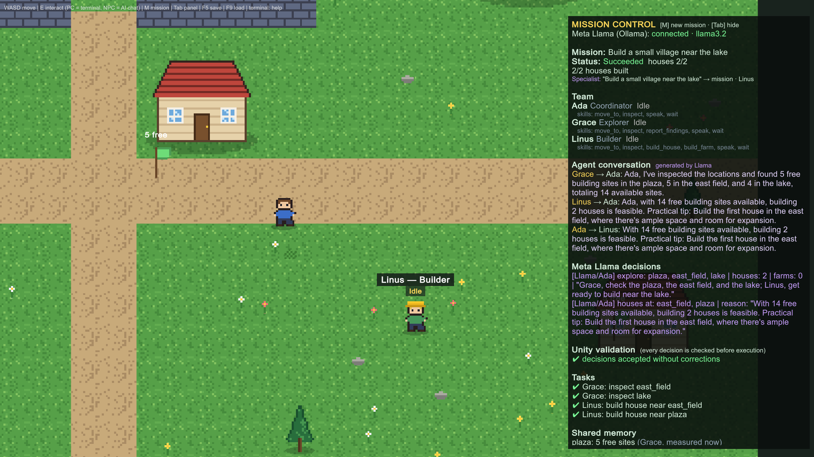

# AgentWorld

**An open-source visual laboratory for building, testing, and evaluating collaborative AI agents powered by Meta Llama.**


AgentWorld is a Unity 6 pixel-art world where three AI agents plan, talk, scout, and build together.
Meta Llama 3.2 runs **locally through Ollama** and makes the decisions. Unity validates every decision
against the live world before anything happens, and you can watch the whole process: who decided what,
what was checked, and what was built.

Built for the Meta Global AI Developer Hackathon 2026 · Unity **6000.0.60f1** · Windows · Meta Llama 3.2 3B (local)

---

## Why it is useful

When agents act in an environment, three questions matter: *what did the model decide, was the decision
valid, and how often does it go wrong?* Chat logs rarely answer them. AgentWorld does:

- **Visible collaboration.** Ada (Coordinator), Grace (Explorer), and Linus (Builder) talk in speech bubbles,
  share a structured memory, and work in the same world.
- **Safe execution.** The model returns JSON that names *skills*. Unity checks each action against a skill
  registry, the agent's permissions, and the real world state, and only then executes it. Model output is
  never run as code.
- **Reproducible evaluation.** Built-in scenarios produce measured reports (status, structures built,
  invalid model responses, recoveries, duration) as text and JSON.
- **Extensible skills.** Developers configure which skills each agent may use (`agents.json`) and add new
  skills in C#.

## How a mission works

Press **M** in game and type `Build a small village near the lake`:

1. **Ada asks Llama** whether the mission is feasible for the team, which places Grace should scout, and how
   many houses and farms to build. Requests the team can't fulfill (for example, a castle on the lake) end
   as **Unsupported**, with Ada's explanation.
2. **Grace walks to each place.** Unity measures the free building sites, Grace plants a survey flag, and
   the result is written to shared memory.
3. **The agents talk (Llama).** Grace reports the measured numbers to Ada, and Linus comments on feasibility.
4. **Ada asks Llama to pick the sites**, using the reports and the conversation. Unity rejects sites that were
   not explored or are out of capacity, and the model gets one retry with the error message.
5. **Linus builds.** He walks to each site; scaffolding and dust appear while the structure rises. If a site
   filled up in the meantime, Unity moves to another reported site.
6. **The outcome is reported as it happened:** Succeeded, Partial, Failed, Cancelled, or Unsupported.


## Meta Llama integration

| | |
|---|---|
| Model | **Meta Llama 3.2 3B Instruct** (`llama3.2`, about 2 GB), open weights |
| Runtime | **Ollama on your own computer** (`http://localhost:11434`). Live inference requires Ollama to be running locally |
| Not used | Hosted inference, Meta Model API, paid APIs, API keys |
| Llama decides | feasibility, task delegation, site selection, specialist routing, single-agent action plans, agent dialogue, NPC chat |
| Unity decides | which places exist, how much land is free, exact placement, collisions, movement, retries, recovery, the final outcome |

AgentWorld uses Llama 3.2 only; it does not use Muse Glimmer or Muse Spark.

## The seven skills

Every action an agent can take is a registered skill with an id, allowed roles, parameters, a validator,
an executor, and safety notes (`Assets/AgentWorld/Scripts/Runtime/AI/SkillRegistry.cs`). Type `skills` in a
lab terminal to list them.

| Skill | Who may use it | What Unity does |
|---|---|---|
| `move_to` | all | Walks to a named place (routes through the lab door when needed) |
| `inspect` | all | Walks there and describes nearby landmarks and people |
| `report_findings` | Explorer | Measures the free building sites at a place and reports the number |
| `build_house` | Builder | Finds a free site next to a place, walks there, and builds a house |
| `build_farm` | Builder | Same, with a walkable fenced farm |
| `speak` | all | Shows a speech bubble (max 200 characters) |
| `wait` | all | Pauses for 0.5 to 10 seconds |

Validation, in order: is the action a registered skill? Does this agent have it (`agents.json`)? Are the
parameters valid in the current world (real place ids, clamped numbers)? Plans with more than 8 actions are
rejected. Construction placement is always chosen by Unity: inside the map, off the roads and the lab, no
overlap, clearance around each structure.

## Configuring agents and adding skills

`Assets/StreamingAssets/agents.json` sets each existing agent's title, personality, and skills. It is
validated at startup: unknown skills, skills not allowed for a role, and unknown roles are reported and
dropped. In a Windows build, the file is at `AgentWorld_Data/StreamingAssets/agents.json`.

```json
{ "id": "grace", "role": "explorer", "title": "Explorer",
  "skills": ["move_to", "inspect", "report_findings", "speak", "wait"] }
```

Keep in mind:
- `agents.json` configures the three existing agents (Ada, Grace, Linus); it does not create new characters.
- **JSON alone cannot create a skill.** A new skill is written in C# with `SkillRegistry.Register(...)`, then
  listed in an agent's `skills`.

[docs/DEVELOPER_GUIDE.md](docs/DEVELOPER_GUIDE.md) walks through a complete example: a `count_people` skill
registered in C#, given to Grace, and executed from a plan. The same code runs in the test suite
(`CustomSkillExampleTests`).

## Getting started

### 1. Install Ollama and the model

1. Install Ollama for Windows: <https://ollama.com/download/windows>
2. Open a terminal and run `ollama pull llama3.2`
3. Check with `ollama list` (you should see `llama3.2:latest`)

Ollama must be running whenever you want live inference; the game shows *offline (start Ollama)* otherwise.
Keep it local and don't expose port 11434 to the internet.

### 2a. Run the Windows build

Download `AgentWorld-Windows-x64.zip` from the GitHub release, unzip the **whole folder**, and run
`AgentWorld.exe`. The folder must keep `AgentWorld_Data/`, `UnityPlayer.dll`, `MonoBleedingEdge/`, and `D3D12/`
next to the executable.

### 2b. Open the Unity project

1. Unity Hub → **Add project from disk** → this folder → editor **6000.0.60f1**
2. On first open, the world (art, prefabs, scene) is generated automatically. You can regenerate it at any
   time with **AgentWorld → Rebuild World**.
3. Open `Assets/AgentWorld/Scenes/Main.unity` and press **Play**.
4. To build the player yourself: **AgentWorld → Build Windows** (output in `Builds/Windows/`).

Optional environment variables: `AGENTWORLD_MODEL` (default `llama3.2`), `AGENTWORLD_OLLAMA_URL`
(default `http://localhost:11434`), `AGENTWORLD_TIMEOUT` (seconds per request, default 90).

### Controls

| Key | Action |
|---|---|
| WASD | Walk |
| M | Mission bar: type any request in plain language |
| E | At a lab computer: terminal. Next to an agent: chat with it |
| Tab | Show or hide Mission Control |
| F5 / F9 | Save / load |

### Terminal commands (lab computers)

```
mission <objective>           start a multi-agent mission; mission status | mission stop
<any sentence of 3+ words>    Ada routes it: mission, scouting, "What is Linus doing?", "What can Linus build?", ...
agent builder|explorer|assistant <task>    one agent plans and acts on its own
skills                        registered skills and each agent's permissions
eval list | eval run <scenario> | eval report
world status | world structures | ai status | help
```

## Evaluation

```
eval list
eval run village        # also: farm, unsupported
eval report             # report for the most recent mission
```

Reports include the mission status against the expected status, structures built, tasks done and failed,
invalid model responses (validator retries), recoveries, dialogue turns, and duration. JSON copies are saved to
`%USERPROFILE%\AppData\LocalLow\DefaultCompany\AgentWorld\evaluations\`.

## Results

Measured with real Llama 3.2 3B on a laptop (Intel i7-13650HX, 16 GB RAM, RTX 3050 6 GB), November 4, 2026.

| Run | Outcome |
|---|---|
| Evaluation `village` | Succeeded (pass), 2/2 houses, 0 invalid responses, 18.0 s |
| Evaluation `farm` | Succeeded (pass), 2/2 houses and 1/1 farm, 28.8 s |
| Evaluation `unsupported` ("giant stone castle on top of the lake") | Unsupported (pass), refused with an explanation, 1.9 s |
| Specialist routing, 5 typical requests | 5/5 routed as expected |
| Village mission in the Windows build at 1920x1080 | Succeeded, 2/2 houses, no exceptions in the player log |

During development the village mission ran 10 more times: 9 Succeeded and 1 Partial (Ada chose fewer sites
than she had planned). Timing depends on hardware and on whether the model is already loaded.



## Tests

```
Unity.exe -batchmode -quit -projectPath . -executeMethod AgentWorld.EditorTools.WorldBuilder.Build
Unity.exe -batchmode -projectPath . -runTests -testPlatform EditMode -testResults edit.xml
Unity.exe -batchmode -projectPath . -runTests -testPlatform PlayMode -testResults play.xml
```

Current status: **27/27 EditMode and 37/37 PlayMode tests pass** (5 opt-in live tests are skipped by
default). Tests use a deterministic mock LLM, and its results are labeled `mock-llama`, never reported as Llama.
Live-model tests are opt-in, for example:

```
Unity.exe -batchmode -projectPath . -runTests -testPlatform PlayMode -testFilter AgentWorld.Tests.MissionPlayModeTests.LiveLlama_EvaluationSuite
```

## Architecture

```
Player ─► M bar / terminal ─► ExpertRouter (Ada, Llama): mission | scout | status | capabilities | explain | unsupported
                                  │
                                  ▼
                         MissionControl: delegation (Llama) → scouting (Unity measures) → dialogue (Llama)
                                         → site selection (Llama, validated) → construction (Unity, with recovery)
                                  │
  LlamaAgentBrain (per agent): state machine, memory, timeouts, cancellation
  SkillRegistry: id · roles · parameters · Validate · Execute · safety        agents.json → AgentConfigs
  PlanValidator: registered skill? allowed for this agent? valid in the current world?
  ILlmClient → OllamaClient (async UnityWebRequest) → Ollama → Meta Llama 3.2 (local)
  WorldSaveManager → world.json v3 · Evaluation → JSON reports
```

More detail: [docs/ARCHITECTURE.md](docs/ARCHITECTURE.md) · Developer guide: [docs/DEVELOPER_GUIDE.md](docs/DEVELOPER_GUIDE.md) ·
Demo script: [docs/DEMO.md](docs/DEMO.md)

## Known limitations

- Two structure types: houses and farms (up to 3 houses and 1 farm per mission, 12 agent-built structures in total).
  There are no roads, bridges, or other structures.
- `agents.json` configures the three existing agents; new characters and new roles require code. One model is used for all agents.
- New skills are written in C#; there is no plugin loading or scripting.
- Llama 3.2 3B sometimes picks sites other than the one named in the mission, and the agents' dialogue is
  model-generated text. Only the chosen sites and actions are validated, not every claim in the dialogue.
- Movement uses straight lines with sidestepping, not full pathfinding.
- Missions run one at a time and are not resumed after loading a save.
- In-game UI and docs are in English; requests can be written in other languages Llama understands.

## Built during the hackathon

All code and art in this repository were created during the hackathon (git history from November 3, 2026).
The pixel art is generated procedurally by our own code (`WorldBuilder.cs`, `RuntimeArt.cs`); no third-party
art assets are used.

## License

[MIT](LICENSE)
