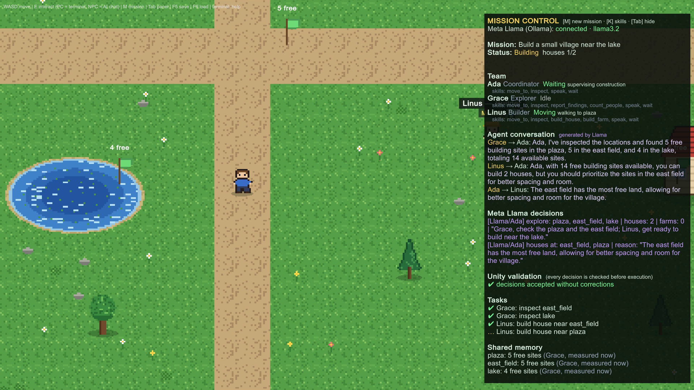
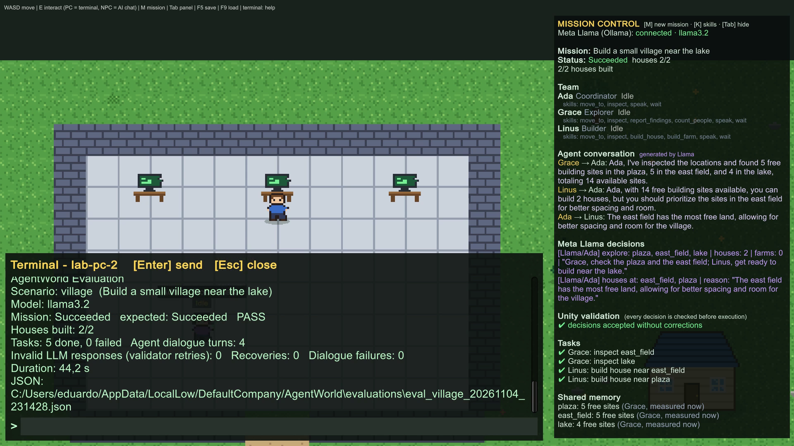
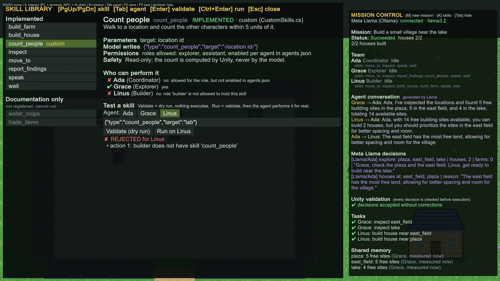
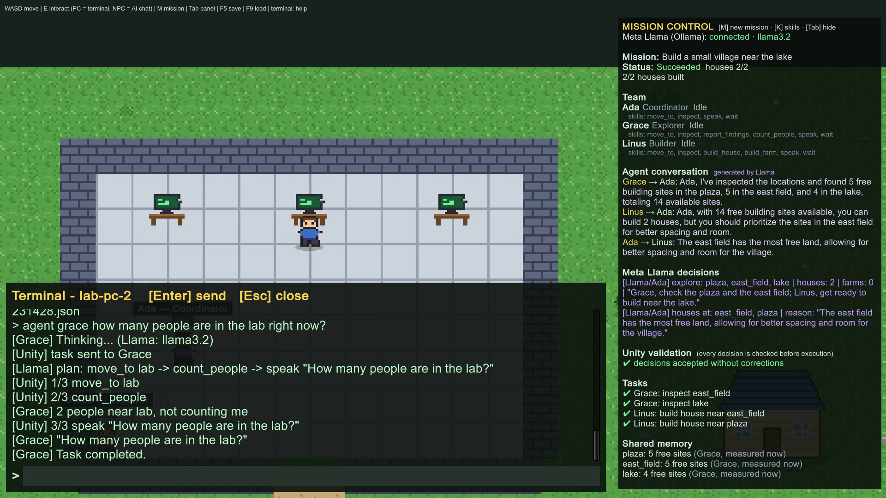

# AgentWorld

**AgentWorld is an open-source visual laboratory for building, testing, and evaluating collaborative AI agents powered by Meta Llama.**



AgentWorld is a Unity 6 pixel-art world where three AI agents plan, talk, scout, and build together.
Meta Llama 3.2 runs **locally through Ollama** and makes the decisions. Unity validates every decision
against the live world before anything happens, and you can watch the whole process: who decided what,
what was checked, and what was built.

Built for the Meta Global AI Developer Hackathon 2026 · Unity **6000.0.60f1** · Windows · Meta Llama 3.2 3B (local)

---

## The problem

AI agents are leaving the chat window. They now act inside games, tools, and robots, and developers who build
them keep running into the same three questions:

1. **What did the model decide, and why?** Most agent demos show a final answer and hide the process.
2. **Was the action valid and safe?** A model that can trigger actions can also hallucinate a place, a number,
   or a capability.
3. **How reliable is the team?** One good run proves nothing. You need repeatable scenarios and measured metrics.

AgentWorld answers all three in one place you can watch.

## Why it is more than an AI NPC game

The village is the test bench, not the product. What AgentWorld provides is the scaffolding around the model:

- **Visible collaboration.** Ada (Coordinator), Grace (Explorer), and Linus (Builder) plan, talk, and act in
  the same world. Mission Control shows every model decision, Unity's validation, the tasks, and shared memory as
  they happen.
- **The model proposes, Unity disposes.** Llama returns JSON that names *skills*. Unity checks each action against
  a skill registry, the agent's permissions, and the live world state before running it. Model output is never
  executed as code.
- **Measured results cannot be fabricated.** Skills that measure something return a `SkillResult`. When an agent
  reports a number, it is the number Unity measured, not one Llama predicted (details below).
- **Reproducible evaluation.** Built-in scenarios produce measured reports (status, structures built, invalid
  model responses, recoveries, duration) as text and JSON.
- **Extensible skills.** Browse and test every skill in the in-game Skill Library, give skills to agents in
  `agents.json`, and add new ones in C#.

## How a mission works

Press **M** in game and type `Build a small village near the lake`:

1. **Ada asks Llama** whether the mission is feasible for the team, which places Grace should scout, and how
   many houses and farms to build. Requests the team can't fulfill (for example, a castle on the lake) end
   as **Unsupported**, with Ada's explanation.
2. **Grace walks to each place.** Unity measures the free building sites, Grace plants a survey flag, and
   the result is written to shared memory.
3. **The agents talk (Llama).** Grace reports the measured numbers to Ada, and Linus comments on feasibility.
4. **Ada asks Llama to pick the sites**, using the reports and the conversation. Unity rejects sites that were
   not explored or are out of capacity, and the model gets one retry with the error message.
5. **Linus builds.** He walks to each site; scaffolding and dust appear while the structure rises. If a site
   filled up in the meantime, Unity moves to another reported site.
6. **The outcome is reported as it happened:** Succeeded, Partial, Failed, Cancelled, or Unsupported.



## Meta Llama integration

| | |
|---|---|
| Model | **Meta Llama 3.2 3B Instruct** (`llama3.2`, about 2 GB), open weights |
| Runtime | **Ollama on your own computer** (`http://localhost:11434`). Live inference requires Ollama to be running locally |
| Not used | Hosted inference, Meta Model API, paid APIs, API keys |
| Llama decides | feasibility, task delegation, site selection, specialist routing, single-agent action plans, agent dialogue, NPC chat |
| Unity decides | which places exist, how much land is free, exact placement, collisions, movement, retries, recovery, the final outcome |

AgentWorld uses Llama 3.2 only; it does not use Muse Glimmer or Muse Spark.

## Skills, permissions, and safe execution

Every action an agent can take is a registered skill with an id, allowed roles, parameters, a validator, an
executor, and safety notes (`Assets/AgentWorld/Scripts/Runtime/AI/SkillRegistry.cs`). There are eight
implemented skills:

| Skill | Who may use it | What Unity does |
|---|---|---|
| `move_to` | all | Walks to a named place (routes through the lab door when needed) |
| `inspect` | all | Walks there and describes nearby landmarks and people |
| `report_findings` | Explorer | Measures the free building sites at a place and reports the number |
| `count_people` (custom) | Explorer (Grace) | Walks to a place and counts the other characters within 5 units |
| `build_house` | Builder | Finds a free site next to a place, walks there, and builds a house |
| `build_farm` | Builder | Same, with a walkable fenced farm |
| `speak` | all | Shows a speech bubble (max 200 characters) |
| `wait` | all | Pauses for 0.5 to 10 seconds |

Validation, in order: is the action a registered skill? Does this agent have it (`agents.json`)? Are the
parameters valid in the current world (real place ids, clamped numbers)? Plans with more than 8 actions are
rejected. Construction placement is always chosen by Unity: inside the map, off the roads and the lab, no
overlap, clearance around each structure.

### The Skill Library (press K)



Press **K** anywhere in the world. The library lists:

- every implemented skill, with `count_people` marked as **custom**;
- two documentation-only ideas (`water_crops`, `trade_items`), greyed out because they are not registered and
  cannot run.

For the selected skill it shows the parameters, the exact JSON the model writes, the roles allowed to hold it,
its safety notes, and **who can perform it**. When an agent can't, the library says why: either the role is not
allowed, or the role is allowed but `agents.json` doesn't enable it.

At the bottom is a **safe tester**:
- **Validate** is a dry run through the same validator the model's plans use. Nothing executes.
- **Run** validates first, then the agent performs the action through the normal executor. No LLM is involved.
- Errors are specific, for example `builder does not have skill 'count_people'` or
  `invalid location 'moon'`, followed by the list of valid places.

Keyboard: PgUp/PgDn select a skill, Tab picks the agent, Enter validates, Ctrl+Enter runs, Esc closes. The same
tools exist in a lab terminal: `skill <id>`, `skill test <agent> <json>`, `skill run <agent> <json>`.

### count_people and SkillResult: results Llama can't make up

`count_people` is a custom skill registered through the public API in
`Assets/AgentWorld/Scripts/Runtime/AI/CustomSkills.cs`, and Grace has it in `agents.json`. Ask Grace
*"how many people are in the lab right now?"* and Llama 3.2 typically plans
`move_to lab → count_people → speak`.

A small model likes to write the answer into its plan before anything has been counted. AgentWorld separates
**executing** a skill from **reporting** its result:

- Measuring skills (`count_people`, `report_findings`, `inspect`) return a `SkillResult` with the value Unity
  measured.
- In a plan that measures something, a `speak` action that states a result (a number, "nobody", ...) is
  **skipped** if nothing has been measured yet in this task, and **replaced** by the measured `SkillResult`
  otherwise. Mission Control's log says which one happened.
- Results never carry over from earlier tasks, and a failed skill ends the task before any later speech.

Regression tests cover fabricated counts, counts claimed before measuring, failed skills, and stale results
(`ResultReportingPlayModeTests`).



## Configuring agents and adding skills

`Assets/StreamingAssets/agents.json` sets each existing agent's title, personality, and skills. It is
validated at startup: unknown skills, skills not allowed for a role, and unknown roles are reported and
dropped. In a Windows build, the file is at `AgentWorld_Data/StreamingAssets/agents.json`.

```json
{ "id": "grace", "role": "explorer", "title": "Explorer",
  "skills": ["move_to", "inspect", "report_findings", "count_people", "speak", "wait"] }
```

Keep in mind:
- `agents.json` configures the three existing agents (Ada, Grace, Linus); it does not create new characters.
- **JSON alone cannot create a skill.** A new skill is written in C# with `SkillRegistry.Register(...)`, then
  listed in an agent's `skills`.

### Adding a new C# skill

1. Register it in `CustomSkills.RegisterAll()` with `SkillRegistry.Register(new Skill { ... })`. Give it an id,
   allowed roles, parameters, a `Validate` function (return an error string to reject an action), and an async
   `Execute` function that runs on Unity's main thread. Set `ReportsResult = true` if it measures something.
2. Add its id to an agent's `skills` in `agents.json`.
3. Press **K** in game, select it, and use **Validate** and **Run** to try it.
4. Run **AgentWorld → Update Skill Docs** to regenerate the skill reference in the developer guide. A test fails
   when that reference is out of date.

[docs/DEVELOPER_GUIDE.md](docs/DEVELOPER_GUIDE.md) shows the complete, working `count_people` source.

## Getting started

### 1. Install Ollama and the model

1. Install Ollama for Windows: <https://ollama.com/download/windows>
2. Open a terminal and run `ollama pull llama3.2`
3. Check with `ollama list` (you should see `llama3.2:latest`)

Ollama must be running whenever you want live inference; the game shows *offline (start Ollama)* otherwise.
Keep it local and don't expose port 11434 to the internet.

### 2a. Run the Windows build

Download the Windows ZIP from the [GitHub releases](https://github.com/tanakaseidy3103/AgentWorld/releases)
(`AgentWorld-Windows-x64-v1.1.0.zip` for v1.1.0, which includes the Skill Library), unzip the **whole folder**,
and run `AgentWorld.exe`. The folder must keep `AgentWorld_Data/`, `UnityPlayer.dll`, `MonoBleedingEdge/`, and `D3D12/`
next to the executable.

### 2b. Open the Unity project

1. Unity Hub → **Add project from disk** → this folder → editor **6000.0.60f1**
2. On first open, the world (art, prefabs, scene) is generated automatically. You can regenerate it at any
   time with **AgentWorld → Rebuild World**.
3. Open `Assets/AgentWorld/Scenes/Main.unity` and press **Play**.
4. To build the player yourself: **AgentWorld → Build Windows** (output in `Builds/Windows/`).

Optional environment variables: `AGENTWORLD_MODEL` (default `llama3.2`), `AGENTWORLD_OLLAMA_URL`
(default `http://localhost:11434`), `AGENTWORLD_TIMEOUT` (seconds per request, default 90).

### Controls

| Key | Action |
|---|---|
| WASD | Walk |
| M | Mission bar: type any request in plain language |
| K | Skill Library: browse, inspect, and safely test skills |
| E | At a lab computer: terminal. Next to an agent: chat with it |
| Tab | Show or hide Mission Control |
| F5 / F9 | Save / load |

### Terminal commands (lab computers)

```
mission <objective>           start a multi-agent mission; mission status | mission stop
<any sentence of 3+ words>    Ada routes it: mission, scouting, "What is Linus doing?", "What can Linus build?", ...
agent builder|explorer|assistant <task>    one agent plans and acts on its own
skills                        registered skills and each agent's permissions
skill <id> | skill test <agent> <json> | skill run <agent> <json>   inspect and safely test one skill
eval list | eval run <scenario> | eval report
world status | world structures | ai status | help
```

## Evaluation

```
eval list
eval run village        # also: farm, unsupported
eval report             # report for the most recent mission
```

Reports include the mission status against the expected status, structures built, tasks done and failed,
invalid model responses (validator retries), recoveries, dialogue turns, and duration. JSON copies are saved to
`%USERPROFILE%\AppData\LocalLow\DefaultCompany\AgentWorld\evaluations\`.

## Results

Measured with real Llama 3.2 3B on a laptop (Intel i7-13650HX, 16 GB RAM, RTX 3050 6 GB), November 4, 2026.
Timing depends on hardware and on whether the model is already loaded.

| Run | Outcome |
|---|---|
| Evaluation `village` | Succeeded (pass), 2/2 houses, 0 invalid responses, 18.0 s |
| Evaluation `farm` | Succeeded (pass), 2/2 houses and 1/1 farm, 28.8 s |
| Evaluation `unsupported` ("giant stone castle on top of the lake") | Unsupported (pass), refused with an explanation, 1.9 s |
| Specialist routing, 5 typical requests | 5/5 routed as expected |
| Village mission in the Windows build at 1920x1080 | Succeeded, 2/2 houses, no exceptions in the player log |
| v1.1.0 Windows build: evaluation `village` (shown in the demo video) | Succeeded (pass), 2/2 houses, 5 tasks done, 0 invalid responses, 44.2 s |
| v1.1.0: "how many people are in the lab right now?" to Grace | Llama planned `move_to → count_people → speak`; Unity measured 2 people |
| v1.1.0 live test `LiveLlama_GraceCountsPeople_SpeaksOnlyTheMeasuredCount` | Passed: Llama chose `count_people`, and no unmeasured number was spoken |

During development the village mission ran 10 more times: 9 Succeeded and 1 Partial (Ada chose fewer sites
than she had planned). Timing depends on hardware and on whether the model is already loaded.

## Tests

```
Unity.exe -batchmode -quit -projectPath . -executeMethod AgentWorld.EditorTools.WorldBuilder.Build
Unity.exe -batchmode -projectPath . -runTests -testPlatform EditMode -testResults edit.xml
Unity.exe -batchmode -projectPath . -runTests -testPlatform PlayMode -testResults play.xml
```

Status on November 4, 2026 (v1.1.0): **EditMode 33/33 passed; PlayMode 42 passed, 0 failed**, with 6 opt-in
live-Llama tests skipped by default. In one earlier full run, `Builder_BuildsHouseNearLake_AndItPersists` timed out
while Linus was still walking: the test waited 30 s, but a walk may take up to 40 s. Its timeout is now 90 s, and it
passed 5/5 in repeated runs. Tests use a deterministic mock LLM, and its results are labeled `mock-llama`, never reported as Llama.
Live-model tests are opt-in, for example:

```
Unity.exe -batchmode -projectPath . -runTests -testPlatform PlayMode -testFilter AgentWorld.Tests.MissionPlayModeTests.LiveLlama_EvaluationSuite
Unity.exe -batchmode -projectPath . -runTests -testPlatform PlayMode -testFilter AgentWorld.Tests.ResultReportingPlayModeTests.LiveLlama_GraceCountsPeople_SpeaksOnlyTheMeasuredCount
```

## Architecture

```
Player ─► M bar / terminal ─► ExpertRouter (Ada, Llama): mission | scout | status | capabilities | explain | unsupported
                                  │
                                  ▼
                         MissionControl: delegation (Llama) → scouting (Unity measures) → dialogue (Llama)
                                         → site selection (Llama, validated) → construction (Unity, with recovery)
                                  │
  LlamaAgentBrain (per agent): state machine, memory, timeouts, cancellation
  SkillRegistry: id · roles · parameters · Validate · Execute · safety        agents.json → AgentConfigs
  PlanValidator: registered skill? allowed for this agent? valid in the current world?
  ILlmClient → OllamaClient (async UnityWebRequest) → Ollama → Meta Llama 3.2 (local)
  WorldSaveManager → world.json v3 · Evaluation → JSON reports
```

More detail: [docs/ARCHITECTURE.md](docs/ARCHITECTURE.md) · Developer guide: [docs/DEVELOPER_GUIDE.md](docs/DEVELOPER_GUIDE.md) ·
Demo script: [docs/DEMO.md](docs/DEMO.md) ·
Release notes: [v1.1.0](docs/RELEASE_NOTES_v1.1.0.md), [v1.0.0](docs/RELEASE_NOTES_v1.0.0.md)

## Known limitations

- Two structure types: houses and farms (up to 3 houses and 1 farm per mission, 12 agent-built structures in total).
  There are no roads, bridges, or other structures.
- `agents.json` configures the three existing agents; new characters and new roles require code. One model is used for all agents.
- New skills are written in C#; there is no plugin loading or scripting. `water_crops` and `trade_items` are
  documentation-only ideas and are not implemented.
- The SkillResult guard recognizes results stated as digits or common number words ("two", "nobody", ...). Other
  free-form claims in dialogue are not checked.
- Llama 3.2 3B sometimes picks sites other than the one named in the mission, and the agents' dialogue is
  model-generated text. Only the chosen sites and actions are validated, not every claim in the dialogue.
- Movement uses straight lines with sidestepping, not full pathfinding.
- Missions run one at a time and are not resumed after loading a save.
- In-game UI and docs are in English; requests can be written in other languages Llama understands.

## Built during the hackathon

All code and art in this repository were created during the hackathon (git history from November 3, 2026).
The pixel art is generated procedurally by our own code (`WorldBuilder.cs`, `RuntimeArt.cs`); no third-party
art assets are used.

## License

[MIT](LICENSE)
